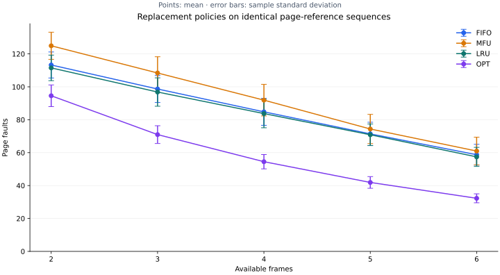

# Page Replacement Lab

[](https://github.com/Nikkilodeonee/page-replacement-algorithms/actions/workflows/ci.yml)

[](LICENSE)

Compare **FIFO**, **MFU**, **LRU**, and the offline **OPT** baseline on identical
page-reference sequences. Run seeded capacity sweeps, inspect per-access traces,
and export full-precision statistics and raw observations.

Started as Operating Systems coursework comparing FIFO and MFU. Extended with
deterministic eviction semantics, two reference policies, paired repeated
experiments, a CLI, structured exports, packaging, tests, and CI.



## Try it

Requires Python 3.10+. The simulation core and tests need no third-party packages.

```bash
git clone https://github.com/Nikkilodeonee/page-replacement-algorithms.git
cd page-replacement-algorithms
python main.py --input examples/belady.txt --frames 3 4 --trace
```

For charts and the installed console command:

```bash
python -m venv .venv
# Linux/macOS: source .venv/bin/activate
# Windows PowerShell: .\.venv\Scripts\Activate.ps1
python -m pip install ".[plot]"
page-sim --frames 2 3 4 5 6 --seed 42 --repetitions 30 --plot
```

The chart is saved as an SVG; no desktop display is needed.

## More memory can cause more FIFO faults

The classic reference string `1 2 3 4 1 2 5 1 2 3 4 5` produces:

| Frames | FIFO | MFU | LRU | OPT |
| --- | ---: | ---: | ---: | ---: |
| 3 | 9 | 10 | 10 | 7 |
| 4 | 10 | 7 | 8 | 6 |

FIFO rises from **9 to 10 faults** when given another frame: Belady's anomaly.
LRU and OPT do not have that capacity anomaly. OPT knows future references and
serves as a lower bound for fault counts, rather than an implementable online
replacement policy.

[Inspect every hit, fault and eviction](examples/belady/trace.csv) ·
[Raw results](examples/belady/runs.csv) ·
[Parameters and summary](examples/belady/summary.json)

## Reproducible experiments

```bash
python main.py --frames 2 3 4 5 6 --length 200 --pages 10 --locality 0.6 --seed 42 --repetitions 30 --plot --output-dir results/capacity
python main.py --frames 3 --length 1000 --locality 0.9 --seed 123 --trace
python main.py --help
```

For repetition i, the generator uses seed + i. **Every algorithm and frame count
receives the same sequence for that repetition.** Changing the order of frame
counts cannot change the workload. Each simulation starts with empty memory.

Locality is the probability of stepping to an adjacent page or staying put,
clamped to the page range. Otherwise the next page is sampled uniformly. It is
a synthetic random-walk model, not a measured application trace.

With 200 accesses, 10 pages, locality 0.6, seeds 42–71, and three frames:

| Algorithm | Mean faults | Sample standard deviation | Mean fault rate |
| --- | ---: | ---: | ---: |
| FIFO | 98.67 | 8.19 | 49.33% |
| MFU | 108.40 | 9.89 | 54.20% |
| LRU | 96.83 | 8.62 | 48.42% |
| OPT | 70.97 | 5.40 | 35.48% |

These observations describe this workload model, not a universal ranking.
Error bars show sample standard deviation, not confidence intervals.
[All observations and workloads](examples/seed-42).

## Policies and tie rules

| Policy | Eviction rule |
| --- | --- |
| FIFO | Earliest loaded resident page; hits do not refresh its order |
| MFU | Most references over the whole run, including earlier residencies |
| LRU | Least recently referenced resident page; hits refresh recency |
| OPT | Page whose next reference is farthest away, or never occurs |

MFU and OPT break ties by evicting the earliest-loaded resident.
This explicit MFU definition preserves the original project's lifetime frequency
counter; other implementations may reset counts on reload.

## Input and output

`--input` accepts a text file containing non-negative integer page IDs separated
by whitespace or commas. A fixed input is simulated **once** regardless of
`--repetitions`: duplicating one trace would not add independent observations.
Generation options are ignored for fixed input.

| Artifact | Contents |
| --- | --- |
| `runs.csv` | One observation per repetition, capacity and policy |
| `workloads.csv` | Every generated reference, with repetition and position |
| `summary.json` | Schema version, effective parameters, means and sample standard deviations |
| `trace.csv` | Optional per-access state for the first workload and first frame count |
| `comparison.svg` | Optional capacity chart with standard-deviation error bars |

Means retain fractional values in reports. Printed values are rounded only for
readability. Exported workloads can be inspected independently; to rerun one,
copy its page column in position order into a whitespace-separated input file.

## Engineering and validation

- Standard-library algorithms with optional, lazy-loaded Matplotlib charts.
- Ordered dictionaries give FIFO/LRU constant-time policy updates per access.
- OPT indexes future positions using queues.
- Separate simulation, experiment orchestration and CLI modules.
- Input validation, isolated random generators, and fresh state for every run.
- **21 tests**, including an independent exhaustive eviction oracle for all
  729 six-reference strings over three pages, textbook counts, MFU ties,
  state/accounting invariants, and reproducible exports.
- GitHub Actions tests Python 3.10/3.12/3.14 on Linux and 3.12 on Windows, plus
  lint, formatting, headless plotting, and package builds.

```bash
python -m unittest discover -s tests -v
python -m pip install ".[dev,plot]"
python -m ruff check .
python -m ruff format --check .
python -m build --no-isolation
```

[Complexity, experiment design, limitations and interview notes](docs/engineering.md)

## Scope

This is an educational trace simulator. It models fixed-size frames with no dirty
pages, write-back costs, TLB, multiprogramming, or real operating-system
integration. Fault counts do not measure wall-clock performance. Workloads and
traces are retained in memory, so very large experiments need a streaming design.

## License

[MIT](LICENSE) · [Roman Sushkin](https://github.com/Nikkilodeonee)
